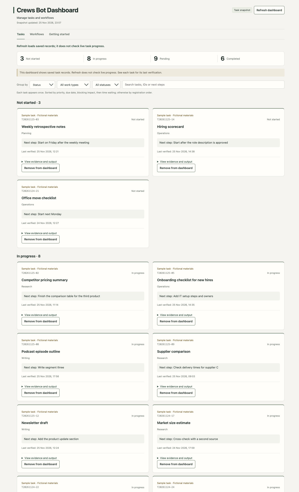
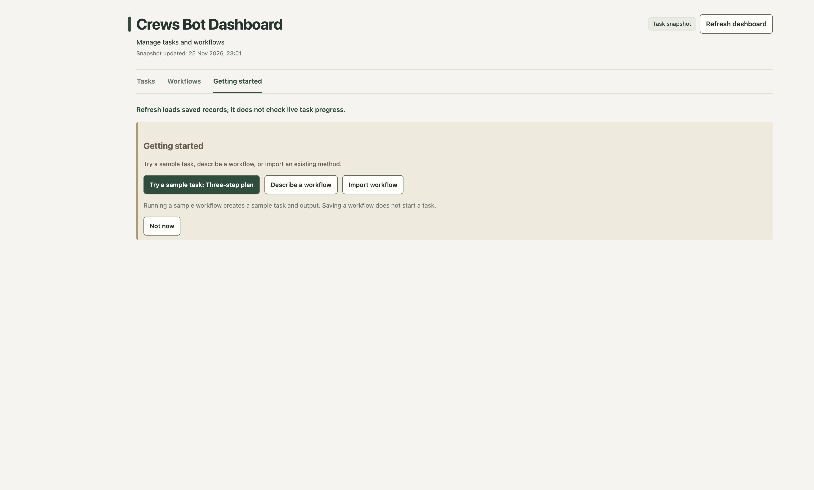
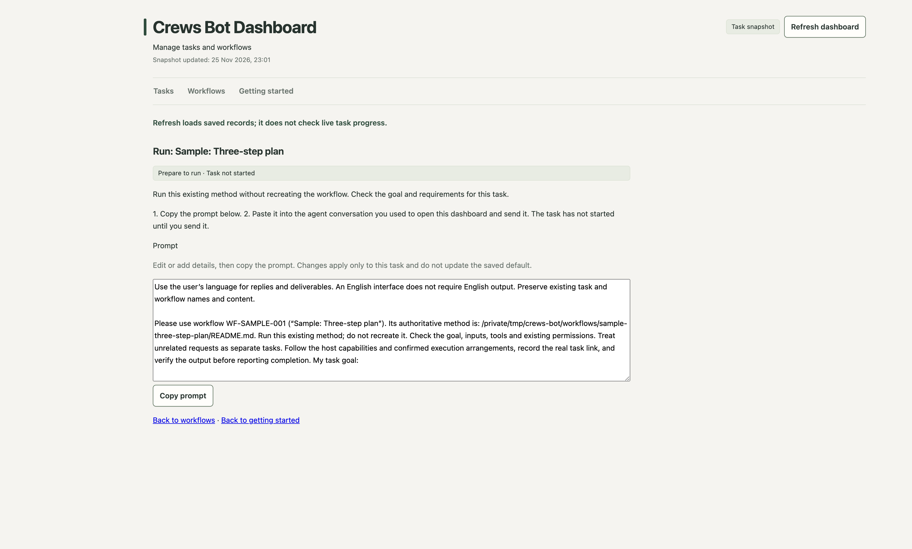

# Crews Bot

**Work with your agent. Keep track of tasks and reuse your workflows.**

When work is spread across agent conversations, it is easy to lose track of progress, next steps and outputs. Crews Bot gives your agent a method for arranging and checking work, a local dashboard that shows every task in one place, and a simple format for saving methods you want to reuse.

<!-- DEMO VIDEO: add the 60–90 second demo here (link or embedded GIF). -->



*Screenshots use fictional sample data.*

## What you get

| Part | What it does |
|---|---|
| Coordinator method | Tells your agent how to take a goal, confirm parameters, arrange execution, verify outputs and report back |
| Dashboard | A local web page showing each task's status, next step and outputs. It reads saved records; it never runs work |
| Workflow format | One file per reusable method: inputs, steps, outputs, acceptance. Describe or import your own |
| Sample workflow | *Three-step plan*, with fictional materials, so you can try the full loop in a few minutes |
| Installer | Installs fixed versions, keeps your data separate, updates and rolls back |

Two concepts: a **task** is a specific piece of work; a **workflow** is a reusable method. Running a workflow creates a task.

## Requirements

- An agent host that can read and write local files. [Codex is fully supported; Cursor, Claude Code, Grok Build, Hermes and OpenClaw are in development](docs/hosts.md).
- Python 3.12 or newer. No other packages.
- Your own model account. Crews Bot is free; the models and tools your agent uses are not.

## Install

Send this to your agent:

```text
Install Crews Bot from https://github.com/TokenBeat-ai/crews-bot by following INSTALL.md.
Preserve any existing data. Then open the dashboard and show me Getting started.
Reply in my language.
```

Or do it yourself: see [INSTALL.md](INSTALL.md).

## Try it



- **Try a sample task: Three-step plan** — your agent drafts a plan from a fictional brief, asks you to review it, pauses, and continues "the next day". No messages are sent and no paid services are used.
- **Describe a workflow** — tell your agent a method you repeat; it structures and saves it.
- **Import workflow** — add a method you already have.

To run a saved workflow, choose **Prepare to run**, edit the prompt if needed, copy it and send it to your agent. Copying does not start anything.



## What it is not

- Not an autonomous background agent. Your host runs the work; the dashboard shows saved records and refreshes only when you ask.
- Not a hosted service. Everything stays on your machine.
- Not a workflow library yet. This release ships one sample workflow; more will be added over time.

## Documentation

- [Install](INSTALL.md) · [Update and roll back](UPGRADE.md) · [Host support](docs/hosts.md)
- [Getting started (for your agent)](general/getting-started.md) · [Coordinator method](general/router-method.md) · [Workflow authoring](general/workflow-authoring.md)
- [Dashboard](dashboard/README.md) · [Terminology](general/terminology.md) · [Changelog](CHANGELOG.md)

## Contributing and license

Contributions are welcome; see [CONTRIBUTING.md](CONTRIBUTING.md). Report security issues as described in [SECURITY.md](SECURITY.md).

Licensed under the [Apache License 2.0](LICENSE). Copyright 2026 TokenBeat AI.
